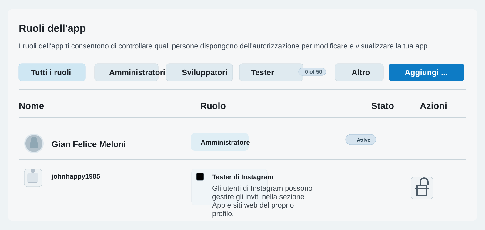

# Configurazione Instagram API Developer

Per far funzionare le chiamate alle API di Instagram dal workflow di GitHub Actions, devi prima creare un'app Meta Developer e collegare un account Instagram Business o Creator.

## 1) Registrati a Meta for Developers

1. Apri https://developers.facebook.com/
2. Accedi con il tuo account Facebook Meta (quello che usa il tuo profilo Instagram Business/Creator).
3. Crea una nuova app:
   - vai su "My Apps" > "Create App"
   - scegli il tipo di app adatto (di solito "Business")
   - compila i campi richiesti

## 2) Abilita il caso d'uso Instagram

Dopo aver creato l'app:

1. Apri il pannello della tua app su Meta for Developers
2. Vai nella sezione "Use cases" (casi d'uso)
3. Seleziona il caso d'uso più adatto al tuo scenario, ad esempio:
   - "Gestisci i messaggi e i contenuti su Instagram"
   - oppure un caso d'uso dedicato alle API di Instagram in base alle funzionalità che vuoi usare
4. Aggiungi il caso d'uso richiesto se non è già presente, usando "Add use case"
5. Verifica che l'account Instagram sia collegato come Business o Creator account
6. Collega il profilo Instagram a una Pagina Facebook, se richiesto dal tipo di app o dal caso d'uso attivato

In pratica, il caso d'uso definisce quale funzionalità dell'API Instagram vuoi abilitare e quali permessi e accessi sono richiesti per usarla correttamente.




## 3) Genera il token di accesso

Per usare le API di Instagram, serve un access token valido.

Metodo consigliato:

1. Apri https://developers.facebook.com/
2. Dal menu a sinistra selezionare Casi d'uso -> Configurazione dell'app con Instagram login -> genera token di accesso
4. Copia il token generato

Esempio di verifica:

```bash
curl -X GET "https://graph.facebook.com/v19.0/me?fields=id,name&access_token=YOUR_ACCESS_TOKEN"
```

Se il token è valido, la risposta conterrà i dati dell'account collegato.

Nota importante:
- I token di accesso vanno trattati come segreti.
- Non pubblicarli nel codice sorgente o nelle logs.
- Usali solo tramite GitHub Secrets.

## 4) Ottieni l'ID dell'account Instagram

Eseguire da command line il seguente comando:

```bash
curl -X GET "https://graph.facebook.com/v19.0/me?fields=id,name&access_token=YOUR_ACCESS_TOKEN"
```

L'ID ottenuto è il valore da usare come `INSTAGRAM_USER_ID`.


## 5) Inserire i valori come secret nel repository GitHub

Nel repository GitHub:

1. Vai su "Settings"
2. Apri "Secrets and variables" > "Actions"
3. Clicca su "New repository secret"
4. Aggiungi almeno questi secret:

- `INSTAGRAM_APP_ID` = ID della tua app Meta
- `INSTAGRAM_USER_ID` = ID dell'account Instagram da usare
- `INSTAGRAM_ACCESS_TOKEN` = token di accesso generato

Esempio di configurazione:

```text
INSTAGRAM_APP_ID = 123456789012345
INSTAGRAM_USER_ID = 17841400000000000
INSTAGRAM_ACCESS_TOKEN = EAAB...token...
```

## 6) Esempio di utilizzo in GitHub Actions

Se il tuo workflow usa le variabili segrete, puoi leggerle così:

```yaml
- name: Call Instagram API
  env:
    INSTAGRAM_APP_ID: ${{ secrets.INSTAGRAM_APP_ID }}
    INSTAGRAM_USER_ID: ${{ secrets.INSTAGRAM_USER_ID }}
    INSTAGRAM_ACCESS_TOKEN: ${{ secrets.INSTAGRAM_ACCESS_TOKEN }}
  run: |
    curl -X GET "https://graph.facebook.com/v19.0/${{ secrets.INSTAGRAM_USER_ID }}?fields=id,username&access_token=${{ secrets.INSTAGRAM_ACCESS_TOKEN }}"
```

## Nota finale

Prima di usare i token in produzione:

- verifica i permessi richiesti
- controlla che l'account Instagram sia un Business/Creator account
- usa sempre secret GitHub e non hardcodare valori sensibili nel repository

Se vuoi, puoi anche aggiungere in questo README un esempio completo di workflow GitHub Actions che usa automaticamente i secret di Instagram.
